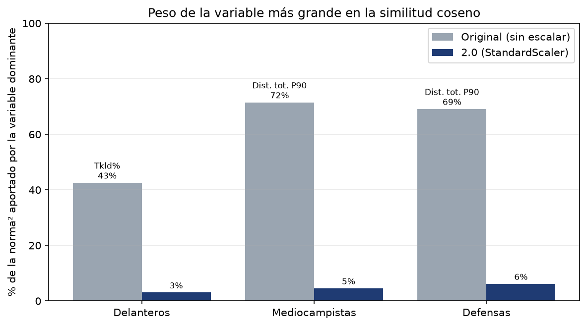
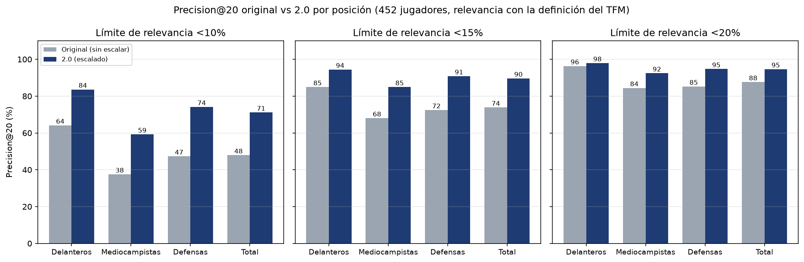
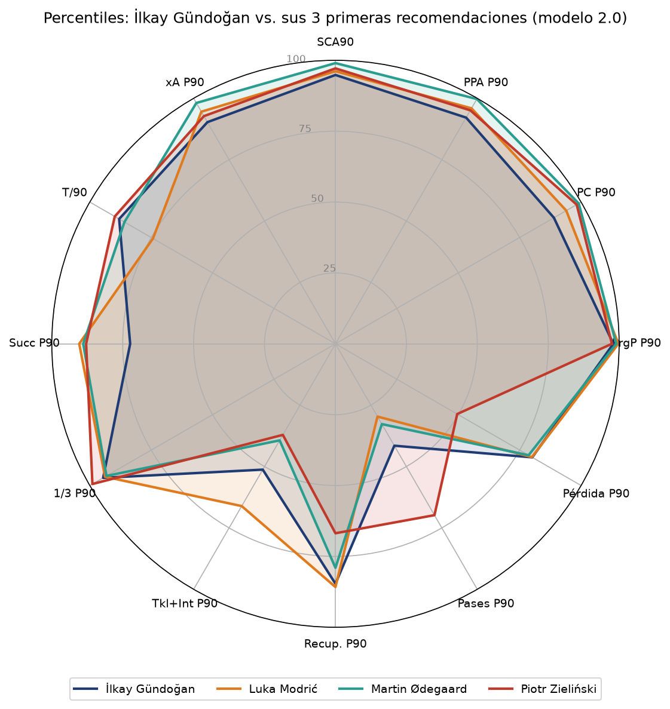

# Recomendador de jugadores de fútbol (versión 2.0)

Recomendador que, dado un jugador de las 5 grandes ligas europeas, devuelve los **20 jugadores con el perfil estadístico más parecido** en su misma posición. Su uso: encontrar reemplazos cuando un club pierde a una pieza clave. Es la versión 2.0, reproducible en Python, de mi Trabajo Final del **Máster en Data Science y Big Data de IEBS (2023)**.

> 🎥 Video del proyecto original (2023): https://youtu.be/W10h_ghe5TE

## Problema de negocio

Cuando un jugador importante se va o se retira, el club tiene que salir al mercado con prisa y con poco poder de negociación. Tener una lista corta de alternativas con un perfil parecido, basada en estadísticas avanzadas y no solo en goles y asistencias, ayuda a la dirección deportiva y al scouting a decidir mejor y a negociar con opciones.

## Datos

- **Fuente:** [FBref](https://fbref.com) (Sports Reference). Las estadísticas avanzadas las proveía Opta (Stats Perform). Datos © Sports Reference / Opta.
- **Cómo se obtuvieron:** en 2023 programé un bot de web scraping con `requests` + `BeautifulSoup` + `pandas.read_html` ([`scraper_fbref_legacy.py`](scraper_fbref_legacy.py)). Descargó 9 tablas por equipo y temporada: estándar, tiros, pases, tipos de pase, creación de goles y tiros, defensa, posesión, tiempo jugado y diversas.
- **Cobertura:** Premier League, La Liga, Serie A, Bundesliga y Ligue 1, temporadas **2017-18 a 2022-23**, **107 equipos**.
- **Tamaño tras la preparación:** **13.639 registros jugador-temporada**, **4.490 jugadores** y 104 estadísticas por jugador.

> ⚠️ **El scraper ya no funciona.** En enero de 2026 FBref eliminó sus estadísticas avanzadas (xG, pases progresivos, acciones de creación de tiro, etc.), porque Opta / Stats Perform terminó su acuerdo de datos ([anuncio de Sports Reference](https://www.sports-reference.com/blog/2026/01/fbref-stathead-data-update/)). Además, hoy FBref responde *403 Forbidden* a las solicitudes automatizadas del script (probado en noviembre de 2026). El script se conserva como **código histórico**.

> ⚖️ **Los datos no están en este repositorio.** Los términos de uso de Sports Reference prohíben redistribuir sus bases de datos, y buena parte de esos datos tenía licencia de terceros. Por eso `data/` está en `.gitignore`. Si tienes los Excel generados por el scraper en 2023, colócalos así:
>
> ```text
> data/raw/Estandar_Total.xlsx      data/raw/Tiros_Total.xlsx        data/raw/Pases_Total.xlsx
> data/raw/Tipo_Pases_Total.xlsx    data/raw/Crea_Gol_Total.xlsx     data/raw/Defensa_Total.xlsx
> data/raw/Posecion_Total.xlsx      data/raw/Tiempo_jugado_Total.xlsx data/raw/Variadas_Total.xlsx
> ```
>
> Cada archivo tiene una fila por jugador, equipo y temporada, con las columnas de FBref en español, más `Equipo`, `Temporada` y `Liga`. Las imágenes del repo son resultados derivados, como percentiles y métricas, no datos crudos.

## Pipeline

```text
scraper_fbref_legacy.py  ->  data/raw/*.xlsx (9 tablas, 2023)
prepare_data.py          ->  data/processed/player_seasons.csv (13.639 x 117)
recommender.py           ->  perfiles por jugador + similitud coseno por posición
evaluate.py              ->  evaluation_results.csv (Precision@20, original vs 2.0)
figures.py               ->  *.png (en la raíz)
app.py                   ->  app Streamlit (opcional, local)
```

1. **Preparación** (`prepare_data.py`):
   - Filtro de temporadas 2017-18 a 2022-23.
   - Selección de columnas de cada tabla y unión por `Jugador + Temporada + Equipo`.
   - Se quitan los registros sin minutos jugados (`Mín > 0`).
   - Los conteos pasan a "por 90 minutos".
   - Solo quedan las temporadas con **más de 5 partidos completos** (`90 s > 5`).
2. **Perfil del jugador:**
   - Promedio de sus temporadas.
   - **Factor de penalización** según cuántas temporadas tiene en la base: 1 → ×0,6, 2 → ×0,7, 3 → ×0,8 y 4 o más → ×1.
3. **Posición:** la que más ocupó (primera posición que lista FBref). Hay tres grupos: delanteros (DL), mediocampistas (CC) y defensas (DF). Los porteros quedan fuera.
4. **Selección de variables:** se calcula el percentil de cada jugador en cada estadística. Para cada posición se usan las variables cuyo percentil promedio en esa posición supera el **60%**.
5. **Similitud:** escalado por columna (`StandardScaler`) dentro de cada posición y **similitud coseno** (`sklearn`). Se recomiendan los 20 más parecidos entre los jugadores activos en 2021-22 o 2022-23, igual que en el original.

## Qué cambió frente al proyecto original

En el TFM, el modelo vivía en un Excel de 83 MB. En la versión 2.0 todo se reproduce en Python, y la variante `original` de `recommender.py` replica la lógica del Excel para poder comparar.

| Tema | Original (2023, Excel) | Versión 2.0 |
|---|---|---|
| Escalado antes del coseno | Ninguno: solo se normalizaba cada fila | `StandardScaler` por columna |
| Unión de tablas | Los duplicados multiplicaban filas (de 22.720 a 23.745) | Se quitan 255 duplicados exactos en Tiros y en Diversas; el merge es 1 a 1 y se valida |
| Temporadas por jugador | Contaba filas (un jugador podía tener 7 u 8 de 6 posibles) | Cuenta temporadas distintas |
| Datos faltantes (p. ej. temporadas en 2.ª división, sin tablas avanzadas) | Se llenaban con 0 | El promedio ignora faltantes; se imputa la mediana de la posición; se excluyen jugadores sin ningún dato avanzado |
| Totales de temporada (xG, xA…) mezclados con tasas por 90 | Sí | Se pasan a "por 90" o se eliminan si ya existía la versión P90 |
| Percentiles | Agrupados en tramos (0,05; 0,20 … 0,99) | Percentil continuo (`rank(pct=True)`) |
| Homónimos | Se mezclaban | Se separan por país (6 casos) |
| Código | Notebooks con rutas absolutas y `try/except` vacíos | Scripts con rutas relativas, configuración central y errores explícitos |

**Por qué importaba el escalado:** sin escalar, la variable con números más grandes domina el coseno. En el modelo original, `Dist. tot. P90` (metros de pase por 90') aportaba en promedio el **72%** de la longitud de los vectores de mediocampistas y el **69%** en los de defensas, y `Tkld%` el **43%** en los de delanteros. Por eso casi todos los pares tenían una similitud de 0,99: el top 20 del original promedia **0,998**, frente a **0,822** en la 2.0.



## Evaluación

No existen datos reales de qué recomendación es "buena", así que, como en el TFM, se usa una **relevancia artificial**: una recomendación es relevante si la diferencia promedio de percentiles con el jugador elegido, en las variables de su posición, es **menor al 10%, 15% o 20%**. La métrica es **Precision@20**, el porcentaje de las 20 recomendaciones que resultan relevantes. Se evaluaron **452 jugadores**: la lista de 493 del TFM, sin porteros ni jugadores sin datos avanzados.

> **Limitación honesta:** la evaluación es **circular**, porque la relevancia se mide con las mismas estadísticas que usa el modelo. Sirve para comparar variantes entre sí, no para demostrar que las recomendaciones funcionan en el mercado real.

**Resultados con la definición de relevancia del TFM** (variables originales por posición):

| Posición | n | Original <10% | 2.0 <10% | Original <15% | 2.0 <15% | Original <20% | 2.0 <20% |
|---|---|---|---|---|---|---|---|
| Delanteros (DL) | 108 | 64,1% | **83,6%** | 84,9% | **94,4%** | 96,3% | **97,9%** |
| Mediocampistas (CC) | 159 | 37,5% | **59,2%** | 68,0% | **84,9%** | 84,4% | **92,4%** |
| Defensas (DF) | 185 | 47,3% | **74,1%** | 72,4% | **90,8%** | 85,2% | **94,7%** |
| **Total** | 452 | 47,9% | **71,1%** | 73,8% | **89,6%** | 87,6% | **94,6%** |

Con la definición de relevancia de la 2.0 (sus propias variables), el total pasa de 33,3% / 62,9% / 81,6% en el original a **64,2% / 92,2% / 98,2%** en la 2.0. El detalle está en [`evaluation_results.csv`](evaluation_results.csv).



*Nota:* el Excel del TFM reportó para el original 43,5% / 85,7% / 97,2% (456 jugadores). La réplica en Python da números distintos por tres razones: los percentiles aquí son continuos y no por tramos, la limpieza de duplicados cambia algunos perfiles y la regla de posición coincide con la del Excel en el 88% de los jugadores. En ambos casos, los mediocampistas son la posición más difícil.

## Ejemplo: reemplazar a İlkay Gündoğan (Manchester City, 2022-23)

| # | Original (réplica del Excel) | 2.0 |
|---|---|---|
| 1 | Frenkie de Jong | Luka Modrić |
| 2 | Mateo Kovačić | Martin Ødegaard |
| 3 | Rodrigo Bentancur | Piotr Zieliński |
| 4 | Arturo Vidal | Christian Eriksen |
| 5 | Kevin Kampl | Julian Draxler |

La réplica coincide con el Excel original: 17 de sus 20 recomendaciones son las mismas, con De Jong y Kovačić en los dos primeros lugares. La 2.0 prioriza mediocampistas creativos, de pase progresivo y creación de tiros, más cerca del perfil real de Gündoğan.



## Herramientas

Python, pandas, NumPy, scikit-learn (`StandardScaler`, `cosine_similarity`), Matplotlib, Streamlit, requests y BeautifulSoup (scraper legado).

## Estructura del repositorio

```text
.
├── README.md
├── requirements.txt
├── .gitignore
├── config.py                 # rutas, temporadas, columnas y factor de penalización
├── prepare_data.py           # paso 1: unión y preparación
├── recommender.py            # paso 2: perfiles, selección de variables y similitud (original y 2.0)
├── evaluate.py               # paso 3: Precision@20
├── figures.py                # paso 4: imágenes
├── run_all.py                # ejecuta los pasos 1 a 4
├── app.py                    # app Streamlit opcional
├── scraper_fbref_legacy.py   # scraper de 2023 (ya no funciona)
├── original_features.json    # variables por posición del modelo original (49 / 46 / 37)
├── eval_players.csv          # lista de jugadores usada en la evaluación del TFM
├── evaluation_results.csv    # resultados de la evaluación
├── *.png                     # gráficos del README (en la raíz)
└── data/                     # NO versionado: raw/ (Excel de FBref) y processed/
```

## Cómo ejecutarlo

```bash
python -m venv .venv
source .venv/bin/activate          # en Windows: .venv\Scripts\activate
pip install -r requirements.txt
# coloca los 9 Excel en data/raw/ (ver "Datos")
python run_all.py                  # preparación + evaluación + imágenes (~1 minuto)
python recommender.py "Karim Benzema"   # top 20 de un jugador, con ambos modelos
streamlit run app.py               # app interactiva (opcional)
```

Probado con Python 3.13.

## Autor

**Daniel Felipe González Ramírez** · [LinkedIn](https://www.linkedin.com/in/daniel-felipe-gonzalez-ramirez-308288173/) · [GitHub](https://github.com/dago1397)

Proyecto realizado como Trabajo Final del Máster en Data Science y Big Data, IEBS (2023). Versión 2.0 reescrita en Python.

---

# Football player recommender (version 2.0)

Given a player from Europe's top 5 leagues, the recommender returns the **20 players with the most similar statistical profile** in the same position, to help find replacements when a club loses a key player. This is the reproducible Python 2.0 version of my final project for the **IEBS Master's in Data Science and Big Data (2023)**.

> 🎥 Original project video (2023): https://youtu.be/W10h_ghe5TE

## Business problem

When an important player leaves or retires, the club has to enter the transfer market under pressure and with little negotiating leverage. A shortlist of statistically similar alternatives, based on advanced stats rather than only goals and assists, helps the sporting director and scouting department decide better and negotiate with options.

## Data

- **Source:** [FBref](https://fbref.com) (Sports Reference). Advanced stats were provided by Opta (Stats Perform). Data © Sports Reference / Opta.
- **How it was collected:** in 2023 I wrote a web-scraping bot with `requests` + `BeautifulSoup` + `pandas.read_html` ([`scraper_fbref_legacy.py`](scraper_fbref_legacy.py)). It downloaded 9 tables per team and season: standard, shooting, passing, pass types, goal and shot creation, defense, possession, playing time, and miscellaneous.
- **Coverage:** Premier League, La Liga, Serie A, Bundesliga, and Ligue 1, seasons **2017-18 to 2022-23**, **107 teams**.
- **Size after preparation:** **13,639 player-season rows**, **4,490 players**, and 104 stats per player.

> ⚠️ **The scraper no longer works.** In January 2026 FBref removed its advanced stats (xG, progressive passes, shot-creating actions, etc.) after Opta / Stats Perform ended their data agreement ([Sports Reference announcement](https://www.sports-reference.com/blog/2026/01/fbref-stathead-data-update/)). FBref also now answers the script's automated requests with *403 Forbidden* (tested November 2026). The script is kept as **legacy code**.

> ⚖️ **The data is not in this repository.** Sports Reference's terms of use forbid redistributing its databases, and much of that data was licensed from third parties, so `data/` is git-ignored. If you have the Excel files the scraper produced in 2023, put the 9 `*_Total.xlsx` files in `data/raw/` (see the list in the Spanish section). The images in this repo are derived results, such as percentiles and metrics, not raw data.

## Pipeline

1. **Preparation** (`prepare_data.py`):
   - Filter to seasons 2017-18 to 2022-23.
   - Select columns from each table and join on `Player + Season + Team`.
   - Drop rows that don't meet `minutes > 0`.
   - Convert counts to per-90 values.
   - Keep only seasons with **more than 5 full matches** (`90s > 5`).
2. **Player profile:**
   - Average of the player's seasons.
   - **Season penalty** based on how many seasons the player has in the data: 1 → ×0.6, 2 → ×0.7, 3 → ×0.8, 4 or more → ×1.
3. **Position:** the one played most often (FBref's first listed position). Three groups: forwards (DL), midfielders (CC), and defenders (DF). Goalkeepers are excluded.
4. **Feature selection:** each player's percentile is computed for every stat. Each position keeps the stats whose average percentile within that position is above **60%**.
5. **Similarity:** per-column `StandardScaler` within each position, then scikit-learn **cosine similarity**. The top 20 is drawn from players active in 2021-22 or 2022-23, as in the original.

## What changed vs. the original

In the original project the model lived in an 83 MB Excel workbook. Version 2.0 reproduces everything in Python, and the `original` variant in `recommender.py` replicates the Excel logic so the two can be compared.

- **Per-column scaling before the cosine.** Without it, the largest-magnitude stat dominated. `Dist. tot. P90` (passing distance per 90) made up about **72%** of midfielder vectors and **69%** of defender vectors, and `Tkld%` about **43%** of forward vectors. As a result, the original top 20 averaged a cosine of **0.998**, versus **0.822** in 2.0.
- **Fixed duplicate rows in the merge.** 255 exact duplicates were removed from the shooting and misc tables, and the join is now validated as one-to-one.
- **Distinct seasons.** The original counted rows, so a player could show 7 or 8 seasons out of 6 possible.
- **Missing data.** The original filled missing values with 0. Version 2.0 averages while ignoring missing values, imputes the position median, and excludes players with no advanced data at all.
- **Season totals.** Totals such as xG and xA are converted to per-90 values, or dropped when a per-90 version already existed.
- **Percentiles.** Continuous percentiles replace the original's bins.
- **Homonyms.** Players who share a name are split by country (6 cases).
- **Code.** Relative paths, central configuration, and explicit error handling.

## Evaluation

There is no ground truth for what a "good" recommendation is, so, as in the original project, relevance is **self-defined**: a recommendation is relevant if its average percentile gap to the chosen player, over that position's features, is **below 10%, 15%, or 20%**. The metric is **Precision@20**, the share of the 20 recommendations that are relevant. **452 players** were evaluated: the original list of 493, without goalkeepers or players lacking advanced data.

> **Honest caveat:** this evaluation is **circular**, because relevance is measured with the same stats the model uses. It is useful for comparing variants, not for proving the recommendations work in the real transfer market.

**Results using the original project's relevance definition:**

| Position | n | Original <10% | 2.0 <10% | Original <15% | 2.0 <15% | Original <20% | 2.0 <20% |
|---|---|---|---|---|---|---|---|
| Forwards (DL) | 108 | 64.1% | **83.6%** | 84.9% | **94.4%** | 96.3% | **97.9%** |
| Midfielders (CC) | 159 | 37.5% | **59.2%** | 68.0% | **84.9%** | 84.4% | **92.4%** |
| Defenders (DF) | 185 | 47.3% | **74.1%** | 72.4% | **90.8%** | 85.2% | **94.7%** |
| **Total** | 452 | 47.9% | **71.1%** | 73.8% | **89.6%** | 87.6% | **94.6%** |

With version 2.0's own relevance definition, the total goes from 33.3% / 62.9% / 81.6% (original) to **64.2% / 92.2% / 98.2%** (2.0).

*Note:* the original Excel reported 43.5% / 85.7% / 97.2% for the original model (456 players). The Python replica differs for three reasons: percentiles here are continuous rather than binned, duplicate cleaning changes some profiles, and the position rule matches the Excel's for 88% of players.

**Example: replacing İlkay Gündoğan (Manchester City, 2022-23).** The original replica returns Frenkie de Jong, Mateo Kovačić, and Rodrigo Bentancur (17 of 20 match the original Excel). Version 2.0 returns Luka Modrić, Martin Ødegaard, and Piotr Zieliński, which are creative, progressive-passing midfielders.

## Tools

Python, pandas, NumPy, scikit-learn, Matplotlib, Streamlit, requests, and BeautifulSoup (legacy scraper).

## How to run

```bash
python -m venv .venv
source .venv/bin/activate          # Windows: .venv\Scripts\activate
pip install -r requirements.txt
# put the 9 Excel files in data/raw/
python run_all.py
python recommender.py "Karim Benzema"
streamlit run app.py               # optional
```

## Author

**Daniel Felipe González Ramírez** · [LinkedIn](https://www.linkedin.com/in/daniel-felipe-gonzalez-ramirez-308288173/) · [GitHub](https://github.com/dago1397)

Final project for the Master's in Data Science and Big Data, IEBS (2023). Version 2.0 rewritten in Python.
